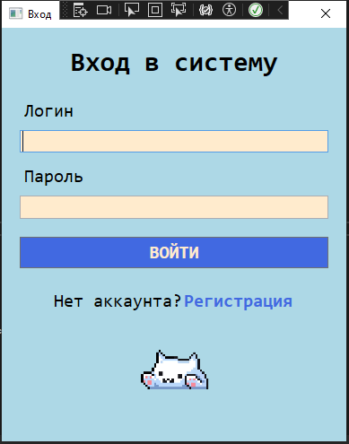
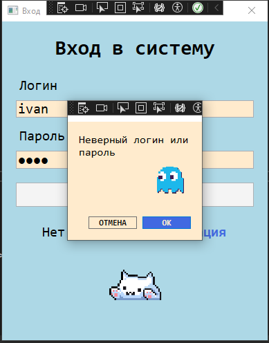
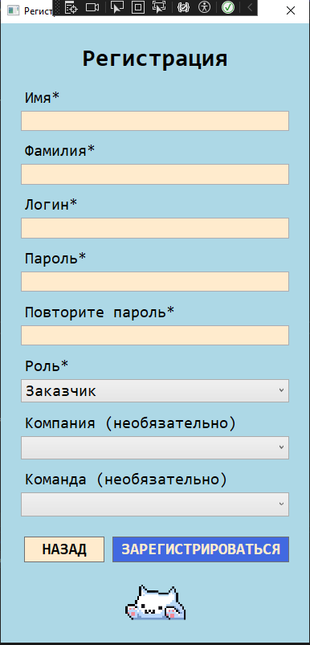
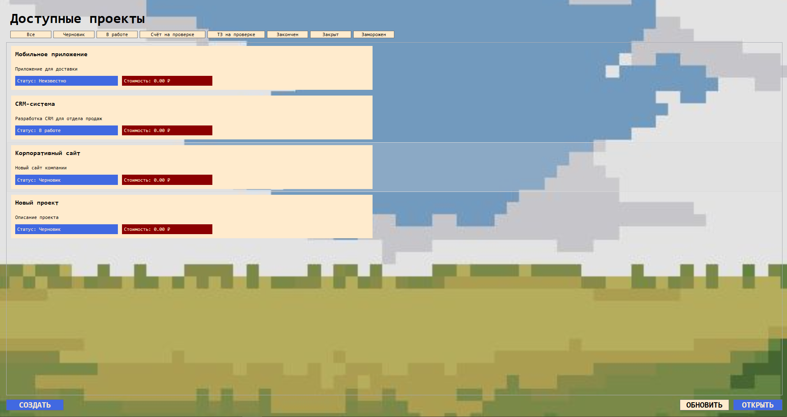
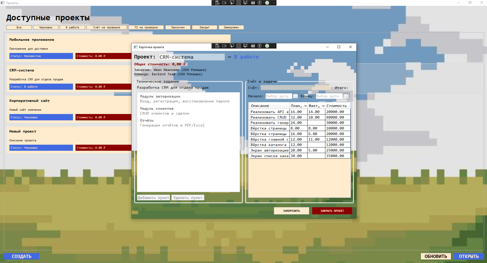
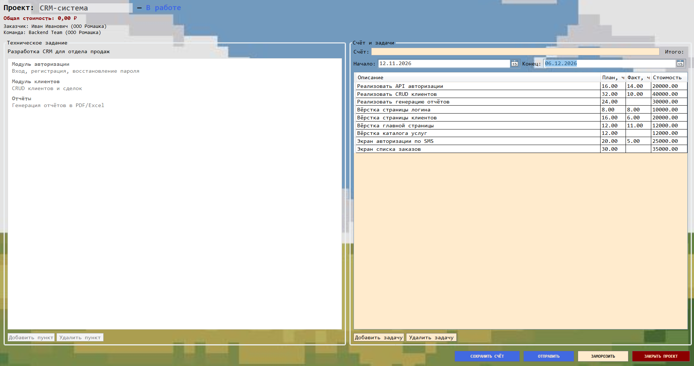
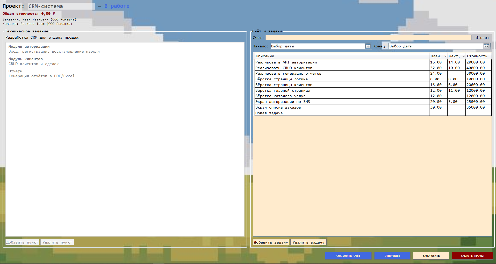

# Система "Команда разработчиков"

Предназначена для взаимодействия заказчика и команды исполнителей.

### Состав системы:
1. [Скрипты для базы данных](https://github.com/Svetlana184/ParamonovKursach/tree/main/%D0%B1%D0%B4)
2. [API](https://github.com/Svetlana184/ParamonovAPI.git)
3. [Настольное приложение](https://github.com/Svetlana184/ParamonovDesktop.git)

### Работа системы 

Экран входа содержит поля логина и пароля и кнопку перехода к регистрации. 

  

При заполнении неверных данных система выводит информационное сообщение.

  

Из экрана входа можно перейти на экран регистрации.

  

После успешной аутентификации открывается окно со списком проектов. В верхней части расположены кнопки фильтрации по статусам. Кнопка создания проекта видна только заказчику. Список проектов показывает название, описание, статус и общую стоимость. Кнопка открытия активна только при выбранном проекте.

  

При открытии или создании проекта открывается экран карточки проек-та, разделенный на две области. Слева расположено техническое задание с пунктами. Справа размещён счёт с задачами и итоговой суммой. В шапке отображаются заказчик, его компания, команда и её компания. 
Видимость и доступность элементов зависят от роли пользователя и ста-туса проекта. Заказчик редактирует ТЗ в черновике и назначает команду. После отправки проекта команде редактирование блокируется. Менеджер заполняет счёт и задачи. Разработчик в этом же статусе вносит фактические часы. В ста-тусе «На одобрении» заказчик принимает или отклоняет изменения и может править ТЗ.

  

Для менеджера карточка проекта будет выглядеть следующим образом:

  

Поскольку проект находится в статусе «В работе», менеджер может ре-дактировать название счета, сроки выполнения проекта, а также добавлять и удалять задачи (см. рис. 4.6.).

  

